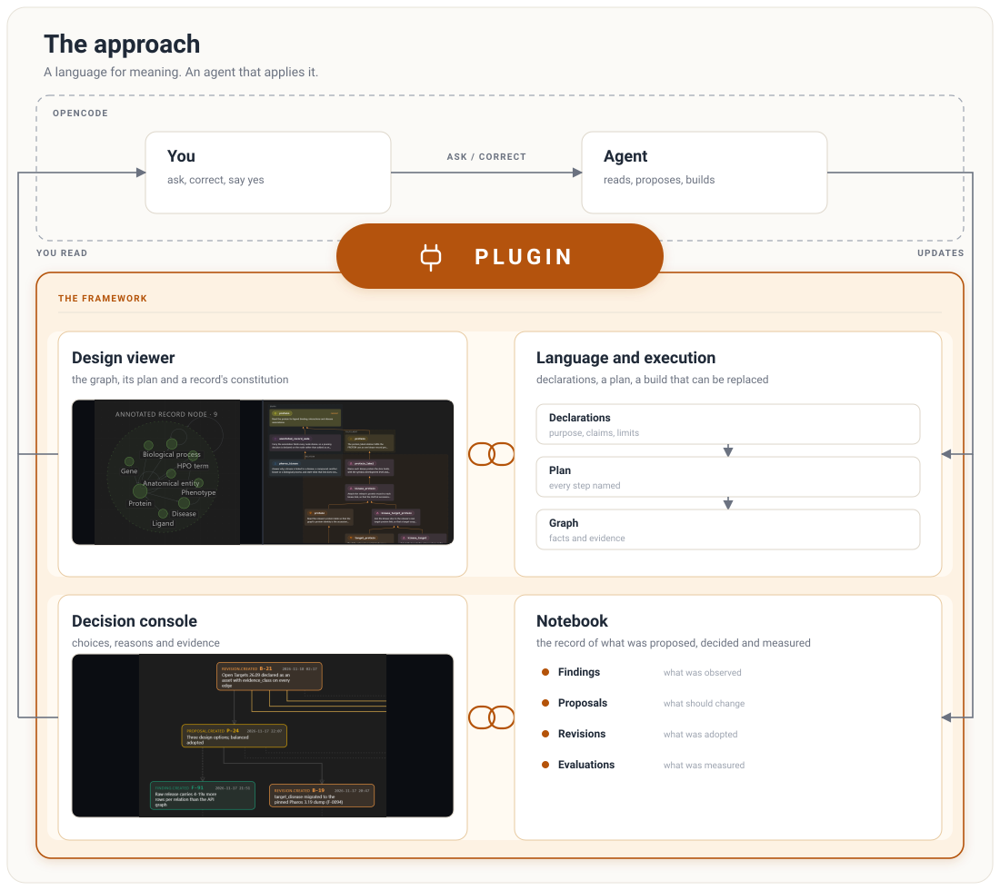
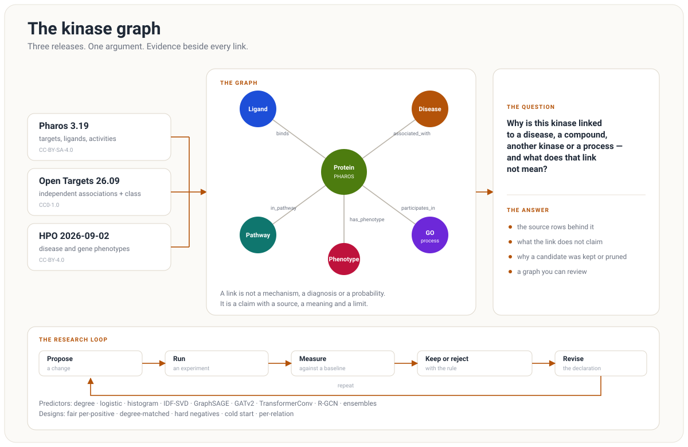
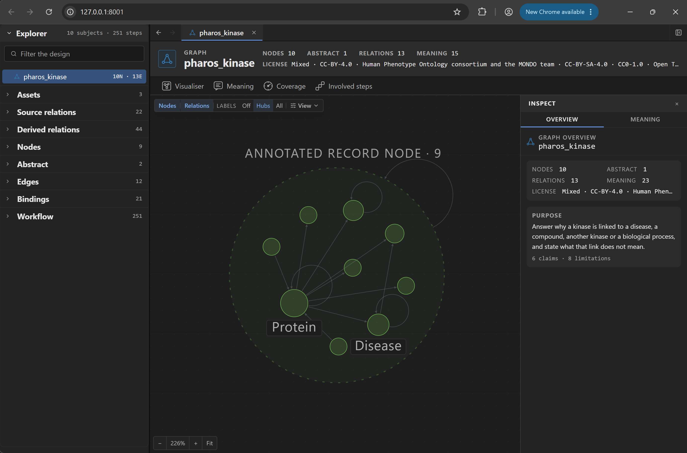
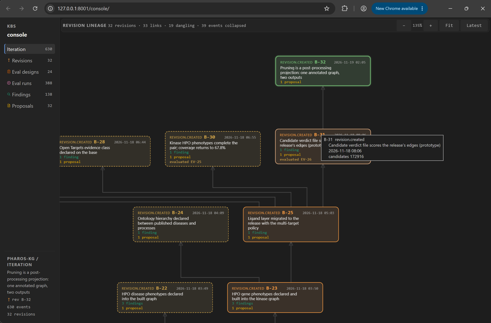
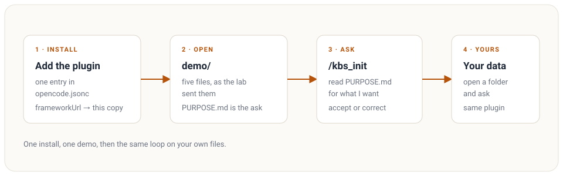

## Why read? Install OpenCode and type “Menu please”

Connect the LLM provider you prefer, then type “Menu please” in this repository
directory. That opens a guided menu:

1. **What is this?** — a guided read of this README, one section at a time.
2. **Show me the graph** — build if needed, then run `kbs up`.
3. **I mean the actual graph** — explain each bundled artifact, its path and its job in the competition.
4. **The graph format is not quite right...** — name the format; I take the author role and change the declarations.
5. **I don't trust you; I want to build it myself** — show `kbs check` and `kbs run`, then step aside.
6. **I still don't trust you; make a new graph for me** — explain the demo story and ask once; that confirmation covers moving, `/kbs_init`, the auto build and the first revision.

The submission is committed in three branches:

| Branch | Contains |
| --- | --- |
| `slim` | Source plus `build/workflow_plan.json` |
| `cache` | `slim` plus the pinned source caches in `data/` |
| `full` | `cache` plus the built graph, evidence, report and meta-graph |

**What you need**
- `uv`
- OpenCode Desktop or the OpenCode CLI

`chdb` has no Windows wheel, so `uv sync` skips it there; the pinned Parquet cache
in `data/` supplies every table without it. Rebuilding from the MySQL dump is a
Linux or macOS task.

# Teaching an agent to build knowledge graphs

A scientist has a folder of exports and a question: which kinases are linked to a
disease, and what is the evidence? Today that question needs a knowledge-graph
engineer. This submission lets them ask an agent — and get a graph they can
review, not just a file they have to trust.

**I built the language, the plugin harness, and the worked graph.**

## What I built

Three artifacts make the argument. The framework gives the graph its language; the
plugin teaches an agent to use it; the graph is the evidence that the method works.
Each is useful on its own, and together they show the loop from a question to a
reviewable graph. The difference is the method, not another agent runtime:
declarations carry meaning, the plan shows every transformation, each record has
evidence, and the ledger keeps the decisions.

Pharos is a pure declaration package: `pharos_kg/` holds the graph, its assets,
relations, bindings and workflow. `kbs` is the only interface — there is no
project-specific build script to learn.

| Part | What it is |
| --- | --- |
| `framework` | The framework — the design language and build engine. Every declaration — graph, node, edge, property, asset, relation and binding — states its purpose, claims and limitations; the graph and relation axes meet at the binding that states fulfilment; every transformation is a step. |
| `plugin` | `opencode-kbs` — the plugin harness in the framework's `plugin/` directory. It teaches a general agent the language, keeps it working step by step, and puts every decision in a console and every graph in a viewer. |
| `graph` | `pharos-kg` — the worked graph. 28,359 nodes and 150,856 links over the 635-kinase family, with 179,215 evidence records. |

Pharos declares 9 node kinds and 12 edge kinds, 165 properties, 22 source and 44
derived relations, and 21 bindings; the plan has 251 steps. `demo/` applies the
same plugin to an antimicrobial-susceptibility dataset, with no domain vocabulary
in the plugin.

**Index**

- [The approach](#the-approach)
- [The proof](#the-proof)
- [Try it](#try-it)

## The approach

Two halves: a framework that gives the graph its language, and an agent that
applies it. The framework is the design; the agent is how a user reaches it. The
figure traces the loop — the user asks in OpenCode, the plugin teaches the method,
and the framework turns declarations into a plan and a graph. The console and
design viewer are the surface the user reviews.



### Framework

A declaration states a purpose with a reader, its claims and its limitations. The
plan names every step; the build can be replaced. That is what makes the graph
reviewable.

| A bare edge | A declared edge |
| --- | --- |
| `EGFR --associated_with--> lung cancer` | **Purpose · claims · limitations · the evidence behind it** |

A declaration reads like this:

> **Purpose:** answer which kinases are associated with a disease, for the analyst
> reading the evidence.
>
> **Limitation:** a reported association is not a mechanism or a clinical claim.

The agent reads each source as it is. Every join, conversion or filter is written
down as a step you can inspect. The plan is the documentation; the check command
reads the argument back, and the console answers “why does this edge exist?” from
the evidence.

### Agent

The agent is the user's OpenCode agent; the plugin is the method. **I did not
build another agent runtime. I built the method that turns an existing agent into
a KG builder.** It works with any capable model and improves with the runtime.

The chat is the control channel; the viewers are the shared state. Ask, read,
correct. The graph is the surface at rest.

## The proof

**The proof is not just the graph; it is the process that authored it.** An AI read
three independent releases, proposed the design, ran the experiments, kept or
rejected the results, and recorded every decision. The graph is what came out; the
ledger is the evidence.



The artifact answers one question: why is a kinase linked to a disease, a compound,
another kinase or a biological process — and what does that link not mean?

### Build it, then open it

From `pharos-kg/`, `kbs` executes the 251-step plan and serves both reading
surfaces. Every model command takes `--project pharos_kg`; without it `kbs`
looks for `manifest.py` in the current directory.

```console
uv sync
uv run kbs blueprint --project pharos_kg
uv run kbs workflow --project pharos_kg
uv run kbs check --project pharos_kg
uv run kbs run --project pharos_kg
```

`kbs blueprint` prints the authored blueprint. `kbs check` reads the argument
back. `kbs run` executes the declared plan and
writes `build/`. A prebuilt copy is included under `pharos-kg/build/`; running
`kbs run` reproduces it. The output is: `graph.jsonl`, `graph.annotated.jsonl`, `evidence.jsonl`,
`workflow_plan.json`, `build_report.json` and the meta-graph.
A cold `data/` downloads and verifies each release before the first build. On a
terminal the run shows live progress; `--no-monitor` leaves the JSON report
alone.

Then start the viewer and the console:

```console
uv run kbs up --project .
```

The design viewer opens at `http://127.0.0.1:8000/` and the decision console at
`http://127.0.0.1:8000/console/`. Add `--no-open` on a remote shell and
`--port 8787` to change the port. `uv run kbs view --snapshot
build/workflow_plan.json` serves the viewer alone, after a build.

| Surface | What to read |
| --- | --- |
| **Design viewer** | The graph and its plan; a record's constitution — graph, node, relation and binding. |
| **Decision console** | Revisions, proposals, findings and the evidence detail; why a candidate was kept or pruned. |

Both surfaces, from the built Pharos graph:

| Design viewer | Decision console |
| --- | --- |
|  |  |

The console is the process; the viewer is the artifact. Both read the same
project: the console from `journal/events/`, the viewer from
`build/workflow_plan.json`.

### The process, and its evidence

| Stage | Evidence |
| --- | --- |
| Read the releases | Pharos 3.19 supplies the kinase universe; Open Targets 26.09 adds independent associations; HPO adds phenotypes. Identity is an accession, never a label. |
| Proposed the design | 9 concrete + 1 abstract node kind; 12 + 1 edge kind; 165 properties; 22 source and 44 derived relations; 21 bindings; a 251-step plan. |
| Built the graph | 28,359 nodes / 150,856 links; 179,215 evidence records. |
| Ran the experiments | 32 revisions and 388 runs across shared-negative, fair, degree-matched, hard, cold-start and per-relation designs. |
| Kept or rejected | measured against the degree prior; adopted IDF-SVD where it beats it; rejected the full phenotype layer; records the shared-negative 0.97 as a protocol artifact. |
| Recorded it | an append-only ledger: 630 events — 32 revisions, 32 proposals, 138 findings, 24 evaluation protocols and 388 runs; 15 withdrawals, never edits. |

Every stage is rerunnable: `kbs check` reads the argument, `kbs run` executes the
251-step plan, the tests and the reconciliation step check the output, and the
ledger records why. The graph file is one output; the process is the other.

What the process produced is reviewable. One edge carries its own argument:
`PHAROS:P00533::ASSOCIATED_WITH::MONDO:0005233` links EGFR to non-small cell lung
carcinoma with independent evidence from Monarch, Expression Atlas, CTD,
DisGeNET and DrugCentral. It states its derivation, its evidence and its meaning:
a source reports an association, not a mechanism or a clinical claim.

Pruning is post-processing: rules annotate a candidate graph, and the shipped
file is the keep projection; reconciliation checks that annotated minus pruned
equals the facts.

Most graphs show what is connected. This one shows how an AI decided what to
connect — and leaves the decision open to inspection.

## Try it

One install, a ready demo, then your own files. The demo is deliberately small and
messy, so the agent has to read it rather than follow a schema. The figure shows the
four moves; the steps below give the exact prompts. Nothing here needs a shell
command from you.



### 1. Install and move in one session

Open a new OpenCode session and give it this one prompt:

> Go to `<submission>`. If the OpenCode plugin is not already installed, install
> it from the included framework's `plugin/` directory into my global
> `~/.config/opencode/opencode.jsonc`, with `frameworkUrl` pointing at the
> included framework. Then move this session to `./demo`.

Replace the first token with the absolute path to the submission folder.

The plugin loads as soon as the entry is written; no restart is needed. The
session is now in `demo/`. If `/kbs_init` does not appear, restart OpenCode once;
the session reopens in `demo/`.

### 2. Run the demo

In the same session, now in `demo/`, say:

```
/kbs_init read PURPOSE.md for what I want
```

The agent reads the four files, proposes the graph and its readers, and stops for
your correction. Accept or correct it; it then works in small steps, records each
decision, and keeps the decision console and design viewer open.

`PURPOSE.md` is the lab lead's request in their own words, not a specification.
The files are deliberately left as the lab sent them; the agent has to read the
data.

### 3. Use your own data

Open any folder with your data in OpenCode and say:

```
/kbs_init build a graph that answers [your question]. Start from the files here.
```

The console and the design viewer are how you see what the agent means.

**Demo:** launchable locally; the declarations and this write-up stand on their own.
